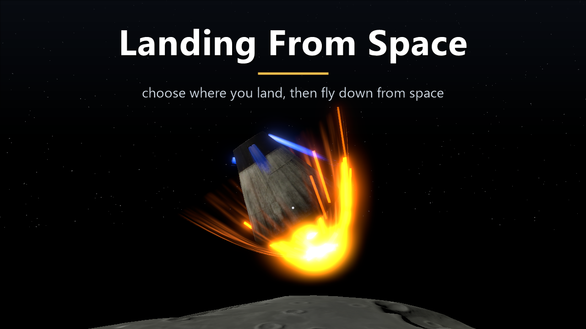

# Landing From Space

A Stationeers mod: choose where you land, then fly your landing capsule down from space.

## Features

- **Choose the spot.** When your capsule spawns, the world map opens. Click where you want to land and press **Land here** (or Enter). **Default spot** lands the normal way. Works on every spawn, including respawns.
- **Guided descent.** The capsule starts 500 m above the point and comes down slowly, seen from an outside camera. **WASD** steers it (the capsule leans with its heat shield facing where it goes), **Shift** falls faster, the **mouse** turns the camera. The last 100 m are the game's own landing.
- **Thrusters and re-entry.** Each thruster flame follows the lean, and a re-entry shock wave of plasma wraps the heat shield while the capsule falls fast.
- **Starting lander.** On a new world, the lander (and the rest of the starting kit) comes down from the sky next to the first player with the mod, as soon as they step out of the capsule.

## Multiplayer

The host needs the mod. Players that also have it get the map and the guided descent; players without it land the normal way. Thruster lean and re-entry effects are only drawn for players with the mod.

## Options

`BepInEx/config/mooka.stationeers.landingfromspace.cfg`: heights, speeds, lean angle, lander radius and fall, camera and effects.

## Requirements

BepInEx + StationeersLaunchPad.

## Building

- `deploy.ps1` builds the mod (`net48`, referencing the game's `Managed` DLLs and BepInEx) and installs it in `Documents\My Games\Stationeers\mods\LandingFromSpace`. Pass `-GameDir` if the game is not in `G:\SteamLibrary\steamapps\common\Stationeers`.
- `selftest.ps1` builds with the self-test, opens a throwaway world in the game, checks the whole landing and reinstalls the normal build. The game must be closed.
- `make-cover.ps1` builds the Workshop images from a 1920x1080 game capture (`cover-source.png`).
